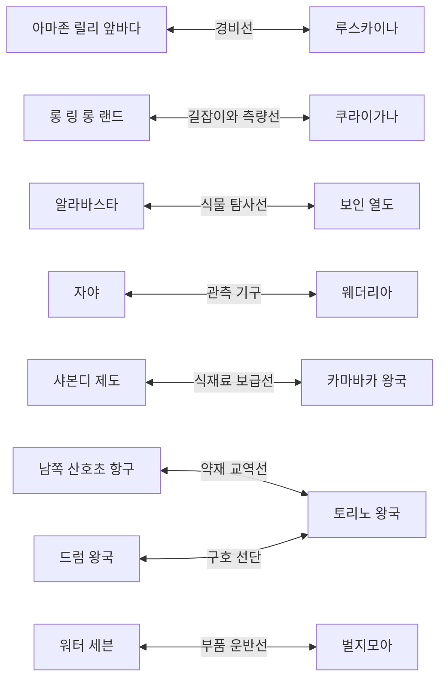

# 일곱 수련 장소와 귀항편

16세부터 출발항의 장면 아래에 **수련 항로**가 열린다. 첫 방문에는 **다음 항로** 창에서도 승선할 수 있다. 섬에서 고른 첫 행동이 다음 실습을 정하고, 실습을 어떻게 마치느냐에 따라 성장과 연표가 달라진다. 처음 도착했을 때 귀항하면 다음 방문에 다시 시작한다. 수련을 마친 뒤에는 같은 배편으로 후일담을 볼 수 있다.

| 출발항 | 수련 장소 | 현지에서 고르는 일 |
|---|---|---|
| 아마존 릴리 앞바다 · 쿠자 경비선 | 루스카이나 | 벌레 소리로 짐승을 추적하거나 우박이 덮은 발자국으로 귀환로를 찾는다. 남성 방문객은 외해 정박지에서 승선한다. |
| 롱 링 롱 랜드 · 폐허 측량선 | 쿠라이가나 | 시케아르 폐허에서 휴먼드릴과 발놀림을 맞추거나 동작을 흉내 내도록 유도해 측량 도구를 돌려받는다. |
| 알라바스타 나노하나 · 식물 탐사선 | 보인 열도 | 팝 그린 씨방을 관찰하거나 접히는 잎 사이로 탈출로를 표시한다. |
| 자야 · 기상 관측 기구 | 웨더리아 | 관측반의 기구로 이동하는 하늘섬에 올라 높이별 바람을 재거나 구름 그림자로 우편선의 항로를 읽는다. |
| 샤본디 제도 · 식재료 보급선 | 모모이로섬의 카마바카 왕국 | 쟁반을 들고 체술 연습 사이를 지나거나 긴 식탁 끝까지 뜨거운 국을 돌린다. |
| 남쪽 산호초 항구 · 약재 교역선 / 드럼 왕국 · 구호 선단 | 사우스 블루의 토리노 왕국 | 현지 채집인과 약초 표본을 구분하거나 거대한 새의 발에 걸린 끈을 풀어 준다. 타고 온 편으로 돌아간다. |
| 워터 세븐 · 기계 부품 운반선 | 겨울섬 벌지모아 | 민간 정비소에서 우편 썰매의 축을 수리하거나 실물에 맞는 도면을 만든다. |

출발항과 운항편은 게임용으로 설정했다. 원작에서 방위가 확인되지 않은 섬은 해도와 길잡이, 납품 일정 또는 관측반의 이동 기구로 찾아간다. 루스카이나에는 정착민을 두지 않았고, 벌지모아에서는 연구소의 파괴 시점과 관계없이 이어질 수 있는 우편 썰매 일을 다룬다.

