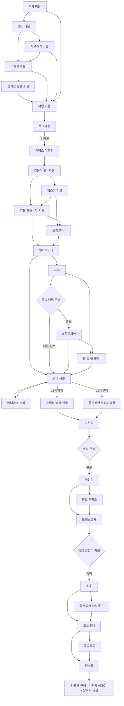
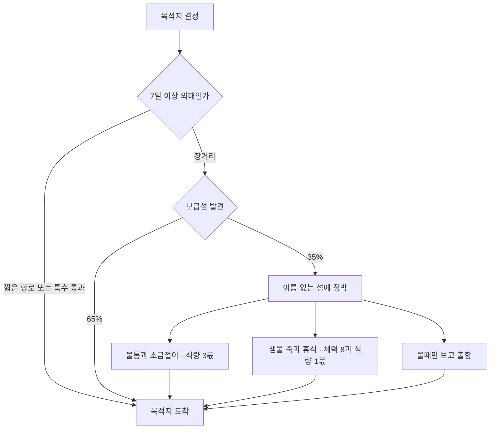

# 섬 항로 분기와 순차 제작 계획

작성일 2026-11-19. 사용자 첨부 그림의 선택→결과→재합류 구조를 항로와 섬 사건에 적용한다.

## 구현 범위와 순서

1. 완료. `data/navigation.ts`에 주요 6, 일반 9, 인연·탐험 6 거점을 지정한다. 그 외 목적지는 탐험 보조 거점으로 둔다.
2. 완료. `core/voyage.ts`와 `core/year.ts`의 일반·해군 항해가 연결 목록을 사용한다. 다음 해역으로 항해하면 위치와 해역을 함께 바꾼다. 지명 조/조우는 조우로 통일하고 옛 저장을 변환한다. 출생지 세부 마을은 대표 항구로 연결한다.
3. 완료. 쌍둥이 곶, 리틀 가든, 드럼 왕국에 각 3장면을 추가한다. 도착 즉시 제안하고, 선택으로 후속 장면을 연다. 리틀 가든은 16~18세에 거인들과의 만남 1장면을 더 연다. 이후 시점은 오리지널 채집가 사건으로 이어진다.
4. 완료. 자야에서 상승 해류 준비, 샤본디에서 코팅 준비, 드레스로자에서 밍크 길잡이를 확보하는 선택을 구현한다. 돈 또는 일손으로 준비할 수 있다.
5. 다음 제작. 루스카이나를 아마존 릴리의 보급선·안내 동의로 연결한다. 보인 열도와 쿠라이가나 섬의 위치는 단순 근접으로 확정하지 않고 해도·길잡이로 접근한다.
6. 이후 제작. 웨더리아의 이동 경로와 항공 이동, 토리노 왕국·테킬라 울프·벌지모아 등 다른 바다에 있는 장소의 선박 항로를 검증한다. 각 장소의 3~6장면 체험과 복귀 항로를 함께 완성한다.
7. 이후 제작. 기존 이야기 속 강제 이동과 해역 진출 선택을 항로 그래프의 특별 이동으로 통합한다. 현 단계의 그래프는 정기 항해에 적용되며, 기존 사건의 `move` 효과는 별도로 존재한다.

`tests/v5/navigation.test.ts`로 목적지 해역, 6/9/6 분류, 조건부 항로, 옛 저장, 도착→후일담을 검증한다. 이후 수련 섬을 열 때마다 도착과 복귀를 같은 검사에 넣는다.

## 일반 항로

화살표는 게임에서 제공하는 연결이다. 원작에서 섬의 거리나 이웃 관계가 확정됐다는 의미로 쓰지 않는다. 본편 항해 순서를 참고한 보급선·의뢰선 연결도 포함한다. 이동하는 조우와 하늘섬에는 별도의 준비가 필요하다.

각 항로에는 머물기 선택을 둔다. 준비를 거절하면 다음 해에 다시 의뢰할 수 있다. 항로가 한 갈래라도 출항할 수 있다. 서·북·남해도 보조 항구 사이에 게임용 연결을 지정하고 각 바다의 출구에서 리버스 마운틴으로 합류한다. 이 보조 항구들의 실제 거리와 이웃 관계는 후속 검증 대상이다.

## 콘텐츠 분류

| 등급 | 장소 | 목표 분량 | 현재 제작 상태 |
|---|---|---|---|
| 주요 6 | 로그타운, 알라바스타, 스카이피아, 어인섬, 드레스로자, 와노쿠니 | 극중 8~12주 | 기존 18편 |
| 일반 9 | 위스키 피크, 리틀 가든, 드럼 왕국, 워터 세븐, 에니에스 로비, 스릴러 바크, 펑크 해저드, 홀케이크 아일랜드, 에그헤드 | 극중 2~4주 | 리틀 가든·드럼·스릴러 바크에 선택형 연속 장면 구현 |
| 인연·탐험 6 | 쌍둥이 곶, 발라티에, 자야, 샤본디, 아마존 릴리, 조우 | 극중 3~10일 | 쌍둥이 곶 첫 판 구현, 다른 곳은 기존 사건·항로 준비 |
| 탐험 보조 | 그 외 항구, 엘바프, 라프텔 근해, 앞으로 제작할 수련 장소 | 장소별 별도 | 전체 신규 장편 완성 전 |

분류는 항로 데이터에 지정했다. 실제 체류 일수는 현재 달력 엔진과 연동되지 않는다. 새 3장면도 목표 분량 전체를 채운 것으로 계산하지 않는다.

### 해역별 등록 목적지

| 게임 해역 | 등록된 섬·항구·해상 지점 |
|---|---|
| 이스트 블루 | 후샤 마을, 셸스 타운, 시모츠키 마을, 오렌지 마을, 진귀한 동물의 섬, 시럽 마을, 해상 레스토랑 발라티에, 코노미 제도, 로그타운 |
| 웨스트 블루 | 오하라 옛터, 마피아 항구, 일리시아 왕국, 서쪽 등대섬 |
| 노스 블루 | 루브니르 왕국, 플레반스 옛터, 스파이더 마일즈, 북쪽 상업 도시 |
| 사우스 블루 | 바테리라, 거인 정착지, 남쪽 산호초 항구, 소르베 왕국 |
| 위대한 항로 입구 | 리버스 마운틴, 쌍둥이 곶, 위스키 피크, 리틀 가든, 드럼 왕국 |
| 위대한 항로 전반 | 알라바스타 왕국, 자야, 스카이피아, 롱 링 롱 랜드, 워터 세븐, 에니에스 로비 |
| 샤본디 제도·어인섬 구간 | 스릴러 바크, 플로리안 트라이앵글, 샤본디 제도, 아마존 릴리, 어인섬 |
| 신세계 전반 | 펑크 해저드, 드레스로자, 조우, 홀케이크 아일랜드 |
| 신세계 후반 | 와노쿠니, 에그헤드, 엘바프, 라프텔 근해 |

표에는 등록 지점 45곳이 있다. 현재 정기 항로에서 서·북·남해 12곳은 각 바다 안에서 출발해야 접근할 수 있고, 아마존 릴리는 외부에서 들어가는 정기 항로가 남은 작업이다. 스릴러 바크와 플로리안 트라이앵글은 같은 뱃길에서 시점에 따라 목적지가 달라진다. 이름 없는 섬은 항해 중 잠시 들르는 곳이어서 등록 지점 수에 포함하지 않았다.

## 안개 해역과 작은 기항지

게임 연표에서 에니에스 로비는 18세 무렵이다. 정기 항로로 워터 세븐을 떠나면 16~18세에는 거대선의 외벽에 올라가고, 19세 이후에는 플로리안 트라이앵글에서 옛 목격 기록을 읽는다. 두 경로에서 오리지널 측심선 방울새 호의 종을 듣는다. 종소리를 구별하거나 끊긴 길이줄을 따라가 측심원 둘을 구한다. 이름 주머니까지 건지면 귀환 전보에 두 사람의 서명을 담을 수 있다. 구조 뒤 두 항로는 샤본디에서 합류한다. 원작의 모리아전과 브룩의 합류는 본편에 맡긴다. [공식 스릴러 바크편](https://one-piece.com/story/thriller_bark/index.html)

셸스 타운에서는 기지 부두의 밀린 품삯, 오렌지 마을에서는 가게 간판과 개, 시모츠키 마을에서는 검술 도장의 마룻장, 진귀한 동물의 섬에서는 희귀 동물의 낚싯줄, 롱 링 롱 랜드에서는 물에 잠긴 길과 유목민의 종자 자루를 다룬다. 다섯 곳은 탐험 보조 기항지로 각각 첫 기항 선택이 있다. 지형과 지역의 성격은 원작을 참고했고, 주민의 의뢰와 직항 연결은 게임용으로 썼다. [이스트 블루편](https://one-piece.com/story/east_blue/index.html) · [가이몬](https://one-piece.com/character/Gaimon/index.html) · [톤지트](https://one-piece.com/character/Tonjit/index.html)

## 이름 없는 섬에서 물자 싣기

외해 항로에 게임용 예상 일수를 붙였다. 예를 들어 워터 세븐에서 안개 해역까지는 8일, 리틀 가든에서 알라바스타까지는 9일이다. 예상 7일 이상인 외해 구간마다 정박 확률은 35%다. 항로를 고르는 항해, 자동 이동, 해군·정부 요원의 전근에 같은 규칙이 쓰인다. 기존 사건의 즉시 이동은 별도로 처리한다.

배에 실을 수 있는 식량은 여섯 몫이다. 다음 장거리 외해로 출항할 때 한 몫을 먹으면 체력이 3 회복된다. 도중 정박해도 목적지, 항로 효과, 방문 기록은 최종 도착 때 한 번 적용된다. 정박 중에도 저장과 이어 하기가 가능하다.

## 밀짚모자 일당의 수련·체류 장소 제작표

| 인물 | 장소 | 게임에서 다룰 체험 | 접근 설계·제작 순서 |
|---|---|---|---|
| 루피 | 루스카이나 | 야생 생존, 기척 관찰, 보급선 귀환 | 2차. 아마존 릴리 출발, 현지 안내 허가. 남성의 여인섬 접근 제한도 처리 |
| 조로 | 쿠라이가나 섬·시케아르 왕국 폐허 | 검술과 휴먼드릴의 모방 행동 | 2차. 확인한 해도와 길잡이, 미호크의 상시 수련 보상은 별도 시점 검증 |
| 우솝 | 보인 열도 | 식충식물 관찰, 팝 그린, 탈출 준비 | 2차. 특수 탐사선 의뢰. 기록 지침으로 찾는 평범한 섬처럼 취급하지 않음 |
| 나미 | 웨더리아 | 기상 관측, 풍향과 항로 예측 | 3차. 이동하는 하늘섬의 방문 기회·하늘 이동 수단 |
| 상디 | 모모이로 섬·카마바카 왕국 | 요리와 체술, 주민과의 관계 | 3차. 해당 바다와 보급선 연결 검증 |
| 쵸파 | 토리노 왕국 | 약초·의학·거대 새와 주민 관계 | 3차. 사우스 블루에서 접근하는 별도 갈래 |
| 프랑키 | 기계장치 섬·벌지모아 | 기계 수리와 안전한 설계도 조사 | 3차. 해당 바다 및 연구소 파괴 전후 시점 검증 |
| 로빈 | 테킬라 울프 → 발티고 | 강제노동 구호, 혁명군 연락망 | 4차. 이스트 블루와 특수 연락선. 발티고 접근·파괴 시점 검증 |
| 브룩 | 하라헷타니아 → 테나게나 왕국 | 음악과 관객, 흥행 계약 | 4차. 최초 도착지와 이후 체류지를 구분하고 이동 경로 검증 |

수련 장소의 지리적 인접은 이번 자료로 전부 확인되지 않았다. 위 표의 특수 연결은 제작 설계안이다. 원작 인물의 수련 결과·본편 합류는 변경하지 않고 주인공의 오리지널 체험을 쓴다.

## 공식 설정 확인 자료

- [라분과 쌍둥이 곶](https://one-piece.com/character/Laboon/index.html)
- [브로기와 리틀 가든의 결투](https://one-piece.com/character/Broggy/index.html)
- [드럼 섬과 의료 사정](https://one-piece.com/anime/80/index.html)
- [루피와 레일리의 루스카이나 수련](https://one-piece.com/anime/516/index.html)
- [웨더리아와 벌지모아](https://one-piece.com/anime/418/index.html)
- [일당의 최초 도착 장소](https://one-piece.com/story/amazon_lily/index.html)
- [로빈 구출과 혁명군 연락](https://one-piece.com/character/vanie_joe/index.html)
- [토리노 왕국의 위치](https://one-piece.com/character/Shamba/index.html)
